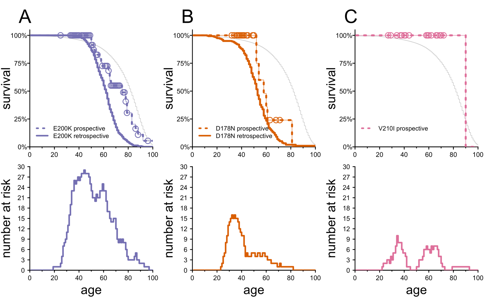

We've just published a new paper updating our estimates of penetrance and age of onset for a few of the most common genetic mutations associated with prion disease risk [[Lian & Kotobelli 2026] ([full text](https://www.vallabhminikel.org/publications/lian-kotobelli-2026-mortality-of-individuals-with-prnp-variants-with-supplement.pdf))]. This blog post will unpack why we have revisited this topic yet again, what is different this time, and what remains to be done.

### introduction

Since the moment we got Sonia's genetic test result nearly 15 years ago, a question at the top of our minds has been, ["does this mean I'll definitely get the disease?"](/2016/01/20/does-this-mean-ill-definitely-get-the-disease/). Age of onset (when) and penetrance (if) disease develops are two sides of the same coin: what is the probability of developing disease for someone with a specific _PRNP_ gene mutation, both at any specific age, and cumulatively over their lifetime? 

The traditional way that other scientists had tried to answer this question was by looking at large families with genetic variants and asking at what ages people developed disease [[Chapman 1994], [Spudich 1995], [D'Alessandro 1998], [Mitrova & Belay 2002]]. The problem is, selecting for large families with a lot of people affected already biases the results towards having, well, more people affected. The largest and most thorough of these studies concluded that lifetime risk, or penetrance, was upwards of 90% for the E200K variant [[Chapman 1994], [Spudich 1995]]. Some studies that suggested that E200K conferred a lower risk, perhaps 60% [[D'Alessandro 1998], [Mitrova & Belay 2002]], but the lack of any raw data or detailed description of methods in these studies left a lot of room for doubt. 

One of our first scientific papers [[Minikel 2016]] revisited the question of lifetime risk using a new method: comparing how common different genetic variants were in cases (people with prion disease) versus population controls (people from the general population, unselected for presence or absence of prion disease). This approach had only just become possible with the advent of large, public, population control datasets (ExAC, now [gnomAD](https://gnomad.broadinstitute.org/)). This approach confirmed that 3 common variants worldwide &mdash; P102L, D178N, E200K &mdash; were indeed highly penetrant, but reclassified several other variants as being of low or no penetrance, because they were too common in the general population. The devil lies in the word _highly_ penetrant. Case/control comparisons are great at distinguishing variants of 0.1% vs. 1% vs. 10% penetrance, but are too low resolution to distinguish between 60% and 90% penetrance.

We therefore revisited this again just a few years later, aggregating data from 9 surveillance and clinical centers worldwide, for data on 1,097 patients with the top 7 genetic variants. We estimated, just like an actuary would, the percent risk of onset in each year of life [[Minikel 2019]]. This effort was distinguished from previous papers in a few ways. First, it was systematic and global, focusing not just on one or a few families but including data from all patients reported in a given time period. Second, we provided life tables summarizing the raw data for anyone to inspect. Third, we made our methods and assumptions transparent by sharing our source code publicly. Still, none of this gets around a fundamental source of bias: we got the data from centers that (mostly) learn about patients only when, and because, they are sick or have already passed away. The data did include a handful of asymptomatic people with predictive genetic testing, but it's impossible to know whether we included "enough" of them to be representative. To whatever extent there are more asymptomatic people out there who never get sick, this study wouldn't have found them.

By this point, we'd seen enough data to know that there were no huge surprises lurking. Sonia's variant, D178N, causes a high lifetime risk of disease. Our hope lies in developing a drug. Finding the bear before it finds us. Still, therein lies another challenge. We think that a trial in presymptomatic people will need to rely on a biomarker (lowering CSF PrP) combined with a follow-up plan to evaluate long-term survival after a drug is approved [[Minikel 2019], [Vallabh 2020]]. For that follow-up plan, it would be really great if we could compare survival of people on drug to the historical data of people off drug. We could compare to the retrospective data from our previous paper [[Minikel 2019]], but are those data good enough?

The right &mdash; meaning less biased &mdash; way to study age of onset and penetrance is longitudinally. Meaning, you identify people with a genetic variant, then follow them over many years to monitor who develops disease. In this new study, we were able to do just this, in collaboration with the National Prion Disease Pathology Surveillance Center.

### summary of the new study

The new study included 404 people who underwent genetic testing between 1998 and 2024. For the main analysis, we focused on 198 people who were asymptomatic at time of test and undergoing predictive genetic testing to find out if they were at risk. We combined autopsy data with public records searches including the Social Security death index and online obituaries to determine whether or not people were still alive.

Half of these people &mdash; 99 individuals &mdash; were E200K carriers. They averaged 46.9 years old when they got genetic testing, and we had on average 9.5 years of follow-up information on them, for a total of 936 person-years of followup. Using the retrospective life tables from our previous paper [[Minikel 2019]], if we apply the percent risk of onset at each year of life to the ages that each person was, we would expect to see 27 of these 99 people develop active disease and pass away during that time window. Instead, we only saw 18 people pass away. That is significantly less than expected. When we model out the risk of disease onset per year of life, we find that the median age of onset is 75, and that the cumulative risk by age 80 is only 69%. In comparison, the 2019 retrospective data had estimated a median age of onset of 62, with 96% risk by age 80.

_Figure 1 from [[Lian & Kotobelli 2026]]. In the top row, each curve shows the estimated percent of people with each PRNP variant surviving as a function of their age. Solid lines show the estimates according to the 2019 retrospective dataset, while dashed lines show the new estimates based on the 2026 longitudinal follow-up dataset. Circles indicate censored observations, meaning, people who were last known to be alive and well at a given age. The thin gray line in the background shows the life expectancy in the general population according to the Social Security Actuarial Life Tables. In the bottom row, each curve shows the number of people in the longitudinal dataset as a function of age. For instance, a person still alive who was tested 10 years ago at age 30 counts towards this curve from ages 30 to 40._ 

Our analysis involved certain assumptions, and so we examined potential reasons our new estimate could be misleading. 

First: if we couldn't find any public record of a person's death, then we assumed they were alive and well. Could we have missed some deaths or people who were symptomatic, but have not yet passed away? This is where it came in handy that we also had data on 206 people who were already symptomatic at the time they underwent genetic testing. Based on typical disease duration and how long ago people were tested, we can make a pretty educated guess as to which of those people must be deceased by now. We found either autopsy records or public records for 174 out of 188 confidently deceased individuals, which is 92.6%, with a confidence interval lower bound of 87.9%. That's quite a good level of sensitivity; in the worst case that the 18 deaths we found records of represented only 87.9% of the true total deaths, that's still only 20.5 deaths. In other words, it's very unlikely that we missed more than 3 deaths. We can model out what the survival curve would look like if there were 21 deaths instead of 18, and the answer is: not that different. 

Second: when we did find a record of someone's death, we assumed it was due to prion disease. Could some people have died of car accidents or cancer, and we erroneously assumed they died of prion disease? Again, we can bound this error mode with some reasonable assumptions. 14 of the 18 deaths in E200K people were autopsy-confirmed; only 4 came from public records with no definitive evidence of the cause of death. So again, we can model out what the survival curve would look like with just 14 deaths instead of 18.

The two error modes described above could push our results a little bit in one direction or the other, making our estimates either too optimistic or too pessimistic about the survival of people with the E200K variant. But importantly it turns out that the range of error is not too great: no matter what you assume, the median age of onset is between 66 and 78, and the lifetime risk through age 80 is 66% to 75%. In all cases, this is better news than what we believed in 2019, when the data we had suggested that the risk by age 80 was 96%.

The main conclusions of the paper are about E200K, because that's the most common variant, and the one for which we have the most data. We also examined D178N and V210I. 

D178N had appeared, based on the 2019 data, to have a median age of onset of 52. In the new dataset, based on 295 person-years of follow-up for 31 unique individuals, the median is 57. That's based on relatively limited data, though (only 6 deaths observed) and is not statistically distinguishable from the old results. So it's slightly good news, if anything, but we don't know for sure if it's news at all. Whether or not the age of onset is slightly higher than we thought, D178N still appears to be nearly completely penetrant by age 80.

V210I was estimated in our 2016 paper to have only 8% lifetime risk &mdash; it is sufficiently common in people of Italian ancestry that if it more reliably caused disease, then we would see a lot more cases of V210I at prion centers than we do see. But as I mentioned earlier, case/control comparisons have very low resolution, and the confidence interval on our lifetime risk estimate was wide. Here, over 187 person-years of follow-up in 26 individuals, we found no evidence of disease onsets. Only 2 people died, and both were after age 90, with public records that did not cite prion disease as the cause of death. We can't put an exact percent estimate on this, but it provides yet another line of evidence confirming that the risk of disease for V210I people is quite low.

### conclusions and limitations

The study we just published could be described as pseudo-prospective. It wasn't truly prospective because we used all retrospective, pre-existing data. But by selecting people based on their genetic tests as a starting point, and then asking about their long-term outcomes longitudinally, we had essentially the same type of ascertainment and analysis as we'd have in a prospective study. All previous retrospective studies were biased towards collecting data on people who did get sick, and missing people who never got sick, whereas, importantly, the approach in this paper did not suffer from this bias.

This new approach has revealed that we were likely a little bit wrong for many years. After years of saying that E200K had 90% or greater lifetime risk, it now appears the true answer is probably more like 70%. This is part of the scientific process: we should believe, but hold lightly, the conclusion based on the best data and best analysis available at the time. Meanwhile we must strive to improve, and be ready to update our beliefs as new data emerge.

This was still not a truly prospective study. We had to make certain assumptions: 1) that "no news is good news", meaning, that people for whom we found no records were alive, and 2) that people who had died, died of prion disease. Our sensitivity tests show that neither assumption would have biased the results so far in one direction as to invalidate our conclusions, but these issues do add uncertainty to our estimates. Even more importantly, our sample size is still very limited, especially for mutations other than E200K, and this limits resolution on our estimates.

### what's next

In my next post, we'll announce the launch of [PROSPECT](https://clinicaltrials.gov/study/NCT07732608), a truly prospective longitudinal study in pre-symptomatic, at-risk genetic carriers. This study is funded by Prion Alliance and by CJD Foundation, and will be run by Brian Appleby at Case Western Reserve University. The study will offer genetic testing, genetic counseling, and long-term annual follow-up to people at genetic risk. Over the coming years, the study will build a large dataset describing the survival and age of onset for each _PRNP_ variant. In the future, when we evaluate potentially preventive drugs for people at risk, PROSPECT will serve two goals. First, the data we have collected can serve both as a historical comparator, quantifying how long people survived before there existed preventive drugs. Second, this study itself can provide the infrastructure for gathering long-term follow-up on people who are on drug.

[Chapman 1994]: https://pubmed.ncbi.nlm.nih.gov/7936296/ "Chapman J, Ben-Israel J, Goldhammer Y, Korczyn AD. The risk of developing Creutzfeldt-Jakob disease in subjects with the PRNP gene codon 200 point mutation. Neurology. 1994 Sep;44(9):1683-6. doi: 10.1212/wnl.44.9.1683. PMID: 7936296."

[Spudich 1995]: https://pubmed.ncbi.nlm.nih.gov/8529127/ "Spudich S, Mastrianni JA, Wrensch M, Gabizon R, Meiner Z, Kahana I, Rosenmann H, Kahana E, Prusiner SB. Complete penetrance of Creutzfeldt-Jakob disease in Libyan Jews carrying the E200K mutation in the prion protein gene. Mol Med. 1995 Sep;1(6):607-13. PMID: 8529127; PMCID: PMC2229975."

[D'Alessandro 1998]: https://pubmed.ncbi.nlm.nih.gov/9872257/ "D'Alessandro M, Petraroli R, Ladogana A, Pocchiari M. High incidence of Creutzfeldt-Jakob disease in rural Calabria, Italy. Lancet. 1998 Dec 19-26;352(9145):1989-90. doi: 10.1016/S0140-6736(05)61335-9. PMID: 9872257."

[Mitrova & Belay 2002]: https://pubmed.ncbi.nlm.nih.gov/12197632/ "Mitrová E, Belay G. Creutzfeldt-Jakob disease with E200K mutation in Slovakia: characterization and development. Acta Virol. 2002;46(1):31-9. PMID: 12197632."

[Minikel 2016]: https://pubmed.ncbi.nlm.nih.gov/26791950/ "Minikel EV, Vallabh SM, Lek M, Estrada K, Samocha KE, Sathirapongsasuti JF, McLean CY, Tung JY, Yu LP, Gambetti P, Blevins J, Zhang S, Cohen Y, Chen W, Yamada M, Hamaguchi T, Sanjo N, Mizusawa H, Nakamura Y, Kitamoto T, Collins SJ, Boyd A, Will RG, Knight R, Ponto C, Zerr I, Kraus TF, Eigenbrod S, Giese A, Calero M, de Pedro-Cuesta J, Haïk S, Laplanche JL, Bouaziz-Amar E, Brandel JP, Capellari S, Parchi P, Poleggi A, Ladogana A, O'Donnell-Luria AH, Karczewski KJ, Marshall JL, Boehnke M, Laakso M, Mohlke KL, Kähler A, Chambert K, McCarroll S, Sullivan PF, Hultman CM, Purcell SM, Sklar P, van der Lee SJ, Rozemuller A, Jansen C, Hofman A, Kraaij R, van Rooij JG, Ikram MA, Uitterlinden AG, van Duijn CM; Exome Aggregation Consortium (ExAC); Daly MJ, MacArthur DG. Quantifying prion disease penetrance using large population control cohorts. Sci Transl Med. 2016 Jan 20;8(322):322ra9. doi: 10.1126/scitranslmed.aad5169. PMID: 26791950; PMCID: PMC4774245."

[Minikel 2019]: https://pubmed.ncbi.nlm.nih.gov/31171647/ "Minikel EV, Vallabh SM, Orseth MC, Brandel JP, Haïk S, Laplanche JL, Zerr I, Parchi P, Capellari S, Safar J, Kenny J, Fong JC, Takada LT, Ponto C, Hermann P, Knipper T, Stehmann C, Kitamoto T, Ae R, Hamaguchi T, Sanjo N, Tsukamoto T, Mizusawa H, Collins SJ, Chiesa R, Roiter I, de Pedro-Cuesta J, Calero M, Geschwind MD, Yamada M, Nakamura Y, Mead S. Age at onset in genetic prion disease and the design of preventive clinical trials. Neurology. 2019 Jul 9;93(2):e125-e134. doi: 10.1212/WNL.0000000000007745. Epub 2019 Jun 6. PMID: 31171647; PMCID: PMC6656649."

[Lian & Kotobelli 2026]: https://pubmed.ncbi.nlm.nih.gov/42662715/ "Lian Y, Kotobelli K, Glisic K, Sprague DA, Vallabh SM, Appleby BS, Minikel EV. Mortality of Individuals With PRNP Variants Associated With Prion Disease in the United States, 1998-2024. Neurol Genet. 2026 Aug 26;12(5):e200423. doi: 10.1212/NXG.0000000000200423. PMID: 42662715; PMCID: PMC13520194."
