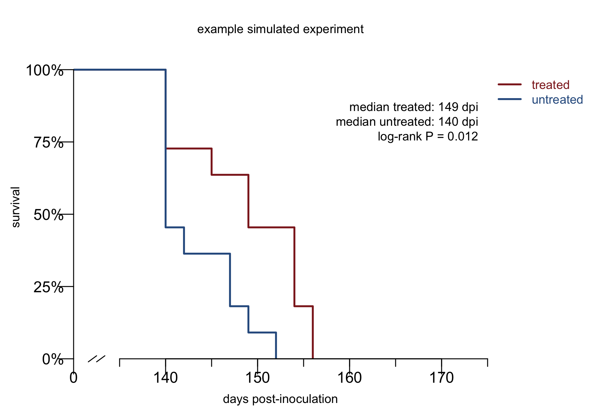
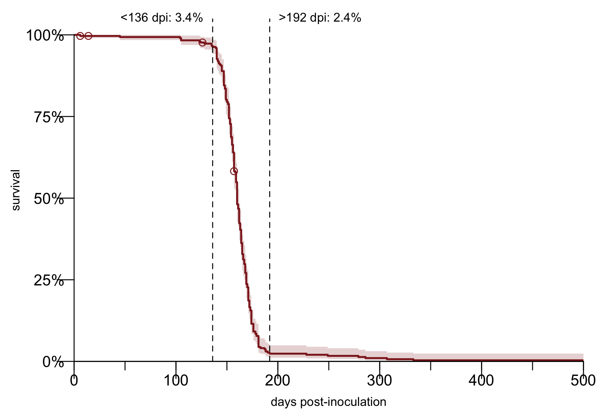
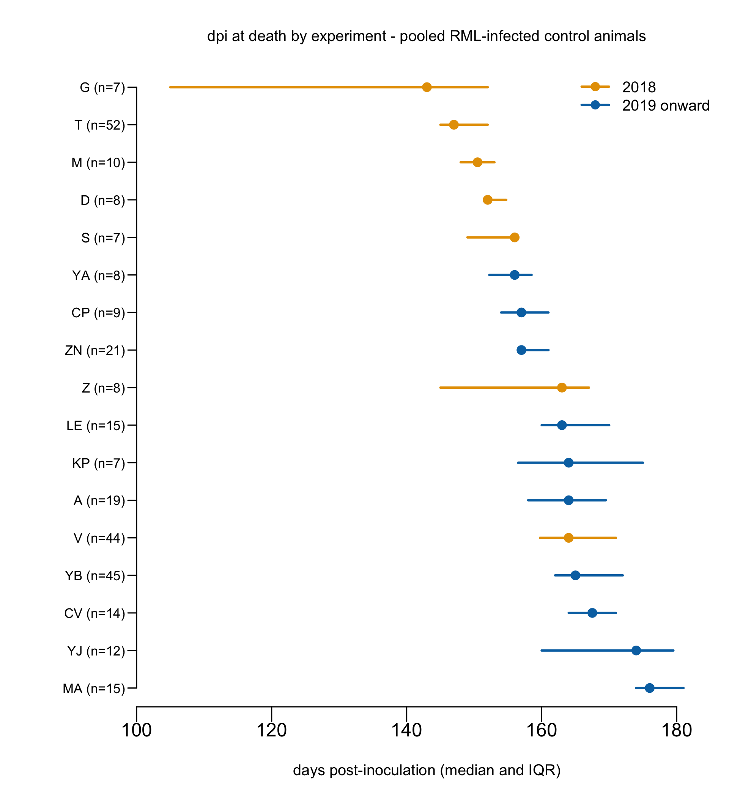

The literature is full &mdash; _full_ &mdash; of claims that such-and-such therapeutic is effective in a prion disease mouse model. When I first began my career change into biomedicine in 2012, I was wide-eyed and credulous, marveling at all the things that seemed to work at least a little bit, increasing survival in a prion-infected mouse by, say, 20%. Go into the [archives](/archives/) and read my early posts and you'll see. It was certainly a shame everything seemed to extend survival only a little bit, but perhaps if we tried these different things in combination, they would work better. When I posed these ideas to experienced prion scientists, they shrugged it off, saying they didn't believe the original claims. Why not, I asked? Most were either too polite to say, or just couldn't quite articulate their intuition, couldn't put words to the weights of their neural network classifier. The biggest task of my first 2 years in science was developing my own intuition, training my own classifier. 

Here in this blog post, at last, are the words to those weights.

### statement of use case

The goal of this blog post is to tell you how to read claims of efficacy &mdash; differences in survival time, symptom onset timing, or healthspan &mdash; in mouse models of prion disease. There are a few prion specifics in here, but a lot of this overlaps with the intuition for reading animal study efficacy claims in any disease model.

### statement of problem

Here is an example survival curve plot simulated from actual data (see below) in which it looks like there is a significant impact on survival, but actually there is not:



The goal of this blog post is to help you recognize, and ignore, these plots and the papers that contain them.

### what models are valid

Before you even evaluate a survival curve, the first question to ask is, in what animal model is this study being done? Is it a valid model?

The standard model in our field is wild-type mice intracerebrally (i.c.) infected with prions and, some days or weeks later, treated with a therapeutic.

My default position: any therapeutic worth advancing should be tested in this model and should work (with "work" to be defined below). 

Rationale: this model is well characterized and widely available and it has a prion infection in its brain, which is the key clinical scenario that needs to be modeled. Yes, there are exceptions and caveats to everything, see below, but first, some models that you should be cautious of.

#### mice infected peripherally

In some studies mice are infected intraperitoneally (i.p.; into the body cavity), or orally, or intramuscularly, and on and on. This is not a model of human prion disease. Genetic and sporadic prion prion disease, which are >99% of human cases, [begin in the brain](/2013/12/16/does-spontaneous-prion-disease-begin-in-the-brain/). Acquired prion disease, while tragic, is too rare to do clinical trials in, and in any case, very few people with acquired prion disease ever knew they were at high risk until they were already symptomatic, meaning, when prions were already in their brain. In these models there is an opportunity for therapies to intercept the prion infection in peripheral tissues &mdash; spleen, lymph nodes, peripheral nerves, gut &mdash; before it reaches the brain. That is a different, and much lower, bar than treating disease that is already in the brain, both because PrP expression is lower in these peripheral tissues, and getting therapeutics into the brain is hard.

#### brain homogenate treated with a drug before inoculation

Mixing your drug candidate into the brain homogenate &mdash; the source of infectious inoculum &mdash; before infecting animals doesn't prove anything. Bleach would be effective. Bleach is not a drug.

#### mice treated prophylactically

Some studies treat mice before they are infected with prions. Here there is some nuance to discuss. Arguably, this could be considered a model of treating people at risk for genetic prion disease before the disease process starts, which is actually the highest and best thing we can aim to do. We can certainly aspire to treat pre-symptomatic people in the clinic &mdash; indeed, [we have a clinical trial arm open](/2026/10/14/prism-presymptomatic-arm-open/) to do that right now. But the risk is of this animal model is that drugs given to mice at this stage could also act simply by inactivating the infectious material before it's actually taken hold in the animal, or by for instance hastening its clearance. Those are artifacts of the model, not relevant processes in the human disease. 

How to balance these considerations? My take: for a drug that you already know works and you understand its mechanism, it is worth trying it in a prophylactic paradigm. I'm very interested in whether the effect is bigger and better than treating the animals only after they are infected. But this generally shouldn't be the _only_ paradigm in which you have efficacy. Our best shot at preventing disease in at-risk people is with a therapy that works across models and across disease stages, and thus, should work in the standard default model too. If there is a compelling therapeutic candidate with a solid mechanistic explanation as to why it would only work in a prophylactic paradigm, then we need to have a very serious conversation about how you'll show that it works clinically. Just going straight to a survival endpoint in at-risk people is not an option; this would be impossible to do in a numerically well-powered, well-controlled way that gives convincing results [[Minikel 2019]].

#### bespoke models, with caveats

There are a number of limitations of the standard model. Mice are small and distantly related to humans. The model uses mouse prions (not human prions). By inoculating the mice we are artificially introducing a huge amount of prions into their brain rather than an infection starting spontaneously, thus precluding any opportunity to intercept a low prion titer. You could make very reasonable arguments for why a number of alternative models are potentially _better_ than the standard model. Maybe we should use genetic models that have PrP mutations and get spontaneously sick. Maybe we should use humanized mice infected with human prions. Maybe we should use monkeys. 

I will concede that for some drugs, with some mechanisms, we _should_ do these experiments, but I am wary of any drug where such a model is the main or only evidence for its efficacy.

As we reviewed in the discussion of our anle138b paper [[Vallabh 2023]], no genetic models available really check all the boxes of recapitulating genuine human genetic prion disease, while also being tractable for therapeutic studies. Many overexpress PrP, or don't get fatal disease, or don't get transmissible disease, or don't have disease features such as weight loss, survival, etc. that are readily quantified. All these aspects introduce risks that a drug might "work" by modifying some aspect of the model that isn't really authentic to the true disease. And most of these genetic models are not well-characterized, widely availble, or widely used by different labs, so if one lab gets an artifactual result, it's difficult for another lab to cross-check it.

Similar arguments apply to humanized mice infected with human prions. In important ways, this is the better mouse model than the standard model. Several drug candidates such as IND24, cpd-b, and anle138b worked in wild-type mice and didn't work in humanized mice. In those drug programs, humanized mice played an absolutely critical role of invalidating a drug candidate before resources were wasted on bringing it to clinical trial. Nonetheless, I would approach with at least some caution any drug where the main or only evidence comes from a humanized model, for the same reasons above. These models are often less well-characterized, may have artifacts like PrP overexpression, may have less quantitative disease endpoints, and maybe exclusive to one lab, making it harder to tell if your result is real. And it's a more dangerous system to work in from a biosafety standpoint. My view is that generally, if you are hoping for a drug to make the leap from mouse to human, it had better be able to make the leap from mouse to mouse, and therefore also work in the default model.

Finally, large animal models like monkey. We're lucky in prion disease to have animal models across many species, but that doesn't mean they're tractable for therapeutic studies [[Mortberg 2022]]. Generally such studies are going to be much smaller and underpowered compared to mouse studies, and use less well-characterized models. 

This is biology. It's very hard to specify hard-and-fast rules and I'm not trying to. None of these points are absolutes. Once you know that a drug works and you know its mechanism, then the details may dictate that you can and should do studies in additional models besides the standard paradigm. But as a general rule you should try the standard paradigm first, and if the therapy doesn't work, then you better have a very good mechanistic understanding of _why_ it only works in some other special model. And to advance it clinically you will need a very convincing argument of _how_ your drug is still going to translate from an animal study to a human clinical trial when it doesn't even translate from an animal study to another animal study.

### what prion-infected mouse survival data look like

Looking back at our last 9 years of in vivo experiments in the Vallabh/Minikel lab, I pulled data on survival of all the controls: wild-type mice i.c. infected with the RML strain of prions. Some received no treatment, some were treated with saline or another vehicle/placebo. In all I found data on N=301 control animals. These should represent the "natural history" of prion infection in the most standard model. Here are the data:



In most papers, you see mouse survival as a waterfall. All the animals survive until say, day 160, when suddenly all of them die within a week or two of each other. Shockingly, that is the true biology of prion disease. But the true reality of lab work is not quite as simple. As you see above, about 3.4% of animals die earlier than expected. In our studies, the earliest animal to be euthanized due to weight loss, our standard endpoint for prion disease, was at 136 days post-inoculation. Before that, causes of death are things like fight wounds, dermatitis, malocculusion, and found dead. From 136 to 192 dpi, the survival curve is indeed an incredibly steep waterfall. From 192 onward the suddenly pancakes out into infinity. The remaining 2.3% of animals are what I call "escapees" &mdash; animals that for some reason survived far longer than the rest of their cohort. We've never been able to figure out exactly why this happens. Air bubble in the inoculum syringe? Needle bent and didn't go into the brain? But while it's rare, it's not negligible. 

The log-rank test only cares about the rank order in which animals died, not the absolute magnitude of change. So having an occasional animal that lives to 300 dpi doesn't make statistics any less valid than an outlier that only lives to 205 dpi. But the fact that some animals in a study often didn't die of prion disease is a caveat that statistics aren't evertything. Both the 3.4% of low outliers and the 2.3% of high outliers are worth keeping in mind, to remember that there are things other than the true biology that your experiment is inadvertently measuring.

In our lab, we made a decision early on to report all-cause mortality, so we include all those deaths. Some labs may make a different decision, feeling it's more actually rigorous to only include prion disease-related deaths. There are several problems with this: 1) it's a lot of work to do neuropathology on every animal to determine if they had prion disease, 2) all your animals probably DO have prion disease-related changes in their brain, but that doesn't mean prion disease is what killed them, 3) without a pre-commitment to include all deaths, you are leaving yourself open to a lot of subjectivity and post-hoc outlier exclusion: "oh, animal A died at 80 dpi and animal B died at 300 dpi, they can't have had prion disease, therefore, I won't count them" &mdash; lots of room in there to inadvertently shape the data in the way you wished for it to turn out.

### why P values don't mean a result is real

Our control data are useful for illuminating several reasons why a "significant" increase in survival is often not real.

#### random chance

P < 0.05 means that under the null hypothesis that the treated and untreated groups are drawn from the same distribution, a result this different would happen only 5% of the time. That doesn't guarantee it is real. By chance, you could just be in the 5%. But no one believes that for every 1 false positive that is published there are 19 studies that failed and never got published. Read on.

#### experiment-to-experiment variability

In principle all of the above control mice got exactly the same treatment. We used the same BD insulin syringe to inject 30 microliters of 1% RML brain homogenate into their brain. In practice, there is significant experiment-to-experiment variability. Plotted below are the medians and interquartile ranges for each experiment:



The bars shown in orange are experiments from 2018, when we were still exploring different endpoints for experiments. In some of those experiments, mice were euthanized when they presented 5 prion disease symptoms for 2 consecutive behavioral checks. In others, they were euthanized if they lost 15% body weight relative to baseline. Later on, we standardized on a 20% body weight loss threshold, and all the bars shown in blue are using that standard threshold. The fact that the blue and orange bars differ is not surprising, but it is still important, as it feeds into the subjectivity issue discussed below. More remarkable perhaps is the variance within the blue bars: even with a completely objective, quantitative endpoint, we don't always see the same result. Even within these blue bars, fitting a frailty model reveals that experiments are very significantly different from one another, so this is not just random sampling variance. 

```
Call:
coxph(formula = Surv(dpi, acm) ~ frailty(expt), data = survdata_later)

  n= 165, number of events= 159

              coef se(coef) se2 Chisq DF   p
frailty(expt)                   28.63 6.94 0.00016
```

You can imagine possible explanatory factors, like the batch of inoculum, the age of mice at inoculation, the male/female ratio. But there is also a lot of variability we can't totally explain. 

We're not the first to observe this. The Prusiner lab reported that the wild-type control groups from a series of genetic studies in prion-infectedmice had incubation times varying from 121 to 145 dpi [[Tamguney 2008]]. The ALS Therapy Development Institute sought to reproduce a battery of questionable therapeutic claims in the ALS literature, and found control survival times of 126 to 136 dpi [[Scott 2008]].

If 2 different experiments in the exact same model can differ this much from each other, how can one be sure that 2 different arms of the experiment don't also differ this much just by chance?

#### cages are not independent

A key assumption of the log-rank test is that each observation (here, each mouse) is independent of the others. I've long suspected that this is not true. Mice are housed at up to 5 animals per cage. The health of 1 mouse could affect others, for example, if its behavior disturbs the other mice or it ruins the bedding material before the other animals can build a nest. Now using the aggregated control data here, I sought to ask this question statistically. I fit a mixed effects model to account for the known effects of experiment-to-experiment variability, but ask whether after accounting for these effects, cages still differ:

```
coxph(formula = Surv(dpi, acm) ~ factor(expt) + frailty(cage_id),
    data = survdata)

                     coef se(coef)      se2    Chisq DF       p
# (expt fits omitted)
frailty(cage_id)                            105.5534 38 2.8e-08
```

The answer is that yes, cages are significantly different from each other, P = 2.8e-8.

What that P values doesn't tell you is how often the non-independence of cages might give you a false positive. Using controls from experiment T (Figure 6 from [[Minikel 2020]]), the largest single mouse experiment we ever did (N=52 control mice across 14 cages), I tested 2 scenarios. In one scenario, I sampled 11 treated and 11 untreated mice from _any_ cage and compared them. In the other, I constrained the 11 mice in each group to come from only 3 unique cages &mdash; this is more what real experiments are like. I bootstrapped 1,000 iterations of each simulation. I'm just sampling control mice here and not simulating any treatment effect, so the "correct" answer is that the treated and untreated groups are not different. In the individual mouse sampling approach, I got a false positive 6.0% of the time at P < 0.05, so the P value is reasonably well-calibrated. In the cage-wise sampling approach, I got a false positive 32.1% of the the time at P < 0.05. When the assumptions of the test (in this case, log-rank test) are violated, the P value doesn't mean what you think it means.

#### adding mice inflates the false positive rate

"N-hacking" is a practice in which scientists faced with an almost-significant result add more animals to an experiment in an attempt to get a P value less than 0.05 [[Reinagel 2023]]. This is not hypothetical: I have personally been CCed on email threads in which scientists analyzed interim results from an experiment and discussed whether to add more animals to achieve a significant result.

While the N-hacking is well-studied in the abstract, I tested its relevance for prion studies in particular. As before, I bootstrapped 1,000 iterations, wherein each time, I started with 11 vs. 11 mice. If the P value was greater than 0.05, I added 8 treated animals at a time, up to 3 times (up to 24 additional treated mice) and stopped if a P value < 0.05 was obtained. Again, remember, I'm not simulating any treatment effect, so the "correct" answer is null. Here, when I sampled individual mice from all experiments, I got a false positive at P < 0.05, 12.0% of the time. Another scenario in which P values don't mean what they are supposed to.

N-hacking interacts with the non-independence of cages. When I sampled from experiment T, requiring mice to be grouped into cages, and also adding mice in search of P < 0.05, I got a false positive 46.3% of the time.

Note that publicly releasing raw animal data can help make such practices inspectable. I've seen lopsided mouse studies where one group was N=10 and the other was like N=30 and you really wonder, on what calendar date were the different cohorts of mice inoculated?

#### some endpoints are soft and some experiments are unblinded

As the orange vs blue bars in the forest plot earlier illustrate, different endpoints give different survival times. Anyone in their right mind has the same endpoint criteria within a whole experiment. But some endpoints are subjective. A lot of prion labs euthanize mice at the onset of symptoms, presumably using some set of criteria that are never really spelled out in detail in the Methods section of any of their papers. That approach may work well in the right hands, specifically if the people evaluating the mice are blinded, and have no personal interest in the outcome of study. Often the person handling the mice is a postdoc who knows which mice are treated and whose career depends upon a positive result. Under such circumstances, even a good person who is not consciously trying to commit fraud may have trouble seeing the mice objectively. The temptation to squint at a treated mouse and believe it to be doing slightly better can apparently be overwhelming.

Note that if a therapy doesn't work, this implicit bias will only move the needle a little bit. Among the studies where we euthanized mice based on symptoms, the earliest median was 143 dpi. Among those where we euthanized based on weight loss, the highest median was 176 dpi. So at the very most, squinting at a mouse and convincing yourself it looks better than it does, is not going to buy you more than 33 days. Prion disease is fatal, and ultimately reality will set in.

#### drugs can affect a survival outcome without influencing prion disease biology

All of the above considerations assume that the truth is there is no effect. A final point worth mentioning is that sometimes the effect may be real, but not relevant. We often euthanize mice based on weight loss below some threshold. If a drug causes mice to gain weight, or even just retain water, then it will take them longer to reach that threshold, even if the drug has done nothing about prion replication or neurotoxicity. Conversely, the weight loss is measured relative to some baseline weight, so depending on the timepoint when treatment is started, a drug that makes the mice lose weight early on in treatment, around the time of baseline, could also set a lower weight that they have to drop below in order to be euthanized.

Animal models are just models. "All models are false, some are useful." But again, remember that prion disease is fatal, so there's a limit to how many days gaining fat or retaining water is going to buy you.

### how to see through all the above caveats

Wow, there are a lot of ways a positive-sounding mouse study can be wrong. How do we see past all those false positives and see only the results that are real?

#### two words: effect size

All the error modes listed above have one thing in common: they create apparent differences that are small in magnitude but significant in P value. The simulated survival curve at top of this post comes from one of the simulations of experiment T, where we sampled cages rather than individual mice, to show that cages are non-independent. In this particular iteration, we got a survival difference of 6%, 149 vs. 140 dpi, P = 0.012. Never believe a survival result plotted on a broken axis.

Unconscious bias can give slightly larger effects &mdash; in the example described above, if a king-of-wishful-thinking postdoc felt the untreated mice to be sick at 143 dpi but let the treated mice go until they were really truly terminally sick at 176 dpi, that would be a 23% difference.

All of the above error modes can combine and stack on top of one another. But they can only stack so high. Prion disease is fatal, and you see that ~98% of our control animals are dead by 192 dpi. Suppose you read a study that says their untreated mice died at a median of 150 dpi, and the treated mice died at a median of 225 dpi, a 50% increase. It is really quite difficult to imagine how any combination of bad statistical practices, unconscious bias, or drug side effects could amount to such a large effect. Absent outright fraud or data fabrication, it's likely to be real. 

So, simple solution: at first pass, only believe things that increase survival at least 50%.

#### replication

If you've got a drug candidate that is really promising, you test it over and over. You try to break your assumptions, convince yourself you were wrong, to see under what circumstances does and doesn't it work. By the time you publish a paper, you have several survival curves from several different experiments. Maybe they are from multiple different investigators at different labs.

Maybe in some of the experiments (lower doses, later treatment, overexpressing mouse) you saw a survival difference that on its own would have been sus, like 15%. But if this 15% is a specific experimental condition in the context of a therapy that worked >50% some of the time, then I'm still willing to believe the 15% _might_ be real. If the biggest effect you ever saw was 35%, but this reproduced across multiple experiments, maybe I could believe that too. Several factors would increase my confidence that a 35% is real: for instance, if you publicly deposited your raw animal data, the endpoints were objective and quantitative (such as weight loss), and you employed strong blinding practices.

### conclusions

In 2013, I had a call with Robi Blumenstein, the president of CHDI (the Huntington's disease research organization). He asked if anything had worked in prion disease mouse models. I said there were some things that increased survival 20%, and that I wondered if they might work in combination. His response has stuck with me forever: "Something that works 20% actually doesn't work at all".

I'm far from the first to come to the conclusions here. Sadly, though, an understanding of these concepts is not sufficiently widespread. That's why I'm writing this blog post.

One error mode is to overemphasize the importance of statistics. In the first draft of our 2020 ASO paper, I wrote that "most differences in outcomes were considered visually obvious and were not subjected to statistical tests". We were not the only ones to settle on such a practice: the Prusiner lab, in its development of IND24 and other 2-aminothiazoles, had also come to the conclusion that statistics were superfluous; instead, they would simply present tables of survival times in days [[Giles 2015]]. A peer reviewer responded, however, that this was "decidedly un-scientific" and asked us to include P values. Sonia forwarded the comments to me and our other co-authors with the comment "we and Referee 3 appear to have a difference of opinion on whether statistical tests are more often used as a means of conveying, or elaborately obfuscating, the truth".

Another error mode is to think that interesting mechanistic stories obviate a rigorous survival result. Of the ocean of bogus survival results out there with 6% effect size and P = 0.012, many are published in no-name journals that no one except my 2012 self, desperate for hope about this disease, would bother to read. But some are published in really, really prestigous journals. What these prestigious publications have in common is that they place a biological mechanism story front-and-center. Figure after figure shows pathway diagrams, Western blots, histopathology, and molecular docking models. Then, buried in Figure 7F, is one single broken axis survival curve with 6% increase in survival, P = 0.012. The abstract says the approach significantly increased survival time in vivo.

False claims of survival benefit do harm. They lead to misallocation of research funds, to clinical trials of therapies that have no prospect of working, and to patients taking drugs off-label. Some of the people who've published these false claims are colleagues, and even friends, who I believe are good people and meant no harm. I don't mean them harm either. But I do want help funders, editors, fellow scientists, physicians, and patients to recognize when survival claims are not credible. As part of a patient-scientist team I have a duty to give you the straight talk that Robi Blumenstein gave me. Our field is at a turning point where therapies that actually _did_ work in vivo are being tested in clinical trials. It's time to focus all our energy on the real hope in front of us.

_[source code](https://github.com/ericminikel/cureffi/blob/gh-pages/media/2026/11/aggregated_controls.R) (with thanks to Claude Sonnet 5) and [control animal data](https://github.com/ericminikel/cureffi/blob/gh-pages/media/2026/11/survdata.tsv). Thanks to Dan Sprague for being my brainstorm partner._

[Tamguney 2008]: https://pubmed.ncbi.nlm.nih.gov/18559949/ "Tamgüney G, Giles K, Glidden DV, Lessard P, Wille H, Tremblay P, Groth DF, Yehiely F, Korth C, Moore RC, Tatzelt J, Rubinstein E, Boucheix C, Yang X, Stanley P, Lisanti MP, Dwek RA, Rudd PM, Moskovitz J, Epstein CJ, Cruz TD, Kuziel WA, Maeda N, Sap J, Ashe KH, Carlson GA, Tesseur I, Wyss-Coray T, Mucke L, Weisgraber KH, Mahley RW, Cohen FE, Prusiner SB. Genes contributing to prion pathogenesis. J Gen Virol. 2008 Jul;89(Pt 7):1777-1788. doi: 10.1099/vir.0.2008/001255-0. PMID: 18559949; PMCID: PMC2828448."

[Scott 2008]: https://pubmed.ncbi.nlm.nih.gov/18273714/ "Scott S, Kranz JE, Cole J, Lincecum JM, Thompson K, Kelly N, Bostrom A, Theodoss J, Al-Nakhala BM, Vieira FG, Ramasubbu J, Heywood JA. Design, power, and interpretation of studies in the standard murine model of ALS. Amyotroph Lateral Scler. 2008;9(1):4-15. doi: 10.1080/17482960701856300. PMID: 18273714."

[Giles 2015]: https://pubmed.ncbi.nlm.nih.gov/26224882/ "Giles K, Berry DB, Condello C, Hawley RC, Gallardo-Godoy A, Bryant C, Oehler A, Elepano M, Bhardwaj S, Patel S, Silber BM, Guan S, DeArmond SJ, Renslo AR, Prusiner SB. Different 2-Aminothiazole Therapeutics Produce Distinct Patterns of Scrapie Prion Neuropathology in Mouse Brains. J Pharmacol Exp Ther. 2015 Oct;355(1):2-12. doi: 10.1124/jpet.115.224659. Epub 2015 Jul 29. PMID: 26224882; PMCID: PMC4576665."

[Minikel 2019]: https://pubmed.ncbi.nlm.nih.gov/31171647/ "Minikel EV, Vallabh SM, Orseth MC, Brandel JP, Haïk S, Laplanche JL, Zerr I, Parchi P, Capellari S, Safar J, Kenny J, Fong JC, Takada LT, Ponto C, Hermann P, Knipper T, Stehmann C, Kitamoto T, Ae R, Hamaguchi T, Sanjo N, Tsukamoto T, Mizusawa H, Collins SJ, Chiesa R, Roiter I, de Pedro-Cuesta J, Calero M, Geschwind MD, Yamada M, Nakamura Y, Mead S. Age at onset in genetic prion disease and the design of preventive clinical trials. Neurology. 2019 Jul 9;93(2):e125-e134. doi: 10.1212/WNL.0000000000007745. Epub 2019 Jun 6. PMID: 31171647; PMCID: PMC6656649."

[Minikel 2020]: https://pubmed.ncbi.nlm.nih.gov/32776089/ "Minikel EV, Zhao HT, Le J, O'Moore J, Pitstick R, Graffam S, Carlson GA, Kavanaugh MP, Kriz J, Kim JB, Ma J, Wille H, Aiken J, McKenzie D, Doh-Ura K, Beck M, O'Keefe R, Stathopoulos J, Caron T, Schreiber SL, Carroll JB, Kordasiewicz HB, Cabin DE, Vallabh SM. Prion protein lowering is a disease-modifying therapy across prion disease stages, strains and endpoints. Nucleic Acids Res. 2020 Nov 4;48(19):10615-10631. doi: 10.1093/nar/gkaa616. PMID: 32776089; PMCID: PMC7641729."

[Mortberg 2022]: https://pubmed.ncbi.nlm.nih.gov/35994510/ "Mortberg MA, Minikel EV, Vallabh SM. Analysis of non-human primate models for evaluating prion disease therapeutic efficacy. PLoS Pathog. 2022 Aug 22;18(8):e1010728. doi: 10.1371/journal.ppat.1010728. PMID: 35994510; PMCID: PMC9436048."

[Vallabh 2023]: https://pubmed.ncbi.nlm.nih.gov/36651748/ "Vallabh SM, Zou D, Pitstick R, O'Moore J, Peters J, Silvius D, Kriz J, Jackson WS, Carlson GA, Minikel EV, Cabin DE. Therapeutic Trial of anle138b in Mouse Models of Genetic Prion Disease. J Virol. 2023 Feb 28;97(2):e0167222. doi: 10.1128/jvi.01672-22. Epub 2023 Jan 18. PMID: 36651748; PMCID: PMC9973041."

[Reinagel 2023]: https://pubmed.ncbi.nlm.nih.gov/37910647/ "Reinagel P. Is N-Hacking Ever OK? The consequences of collecting more data in pursuit of statistical significance. PLoS Biol. 2023 Nov 1;21(11):e3002345. doi: 10.1371/journal.pbio.3002345. PMID: 37910647; PMCID: PMC10619921."

